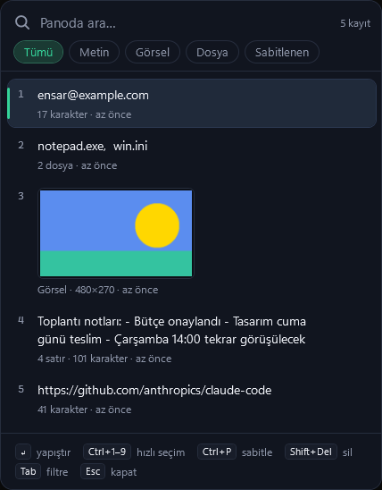
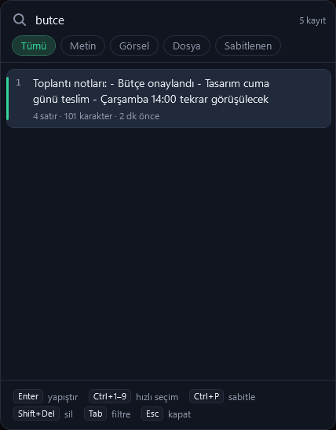

# Pano

Windows için pano (clipboard) geçmişi yöneticisi. Arka planda sessizce çalışır, kopyaladığın her şeyi hatırlar; `Ctrl+Alt+V` ile imlecin yanında açılır, aradığını yazıp `Enter`'a basınca o an çalıştığın uygulamaya yapıştırır.

<p>
  
  
</p>

## İndir

**[Son sürümü indir (Pano.exe)](https://github.com/Enskygr234/pano/releases/latest)**

Tek dosya, kurulum yok. Windows 10/11 (64 bit). Açtığında sistem tepsisine yerleşir.

> Uygulama dijital olarak imzalı olmadığından Windows SmartScreen ilk açılışta uyarı gösterebilir: **Ek bilgi › Yine de çalıştır**.

## Özellikler

- **Metin, görsel ve dosya listeleri** kaydedilir (son 300 kayıt; sabitlenenler hariç).
- **Arama** Türkçe karakterlere duyarsızdır: `butce` yazınca "Bütçe"yi bulur.
- **Doğrudan yapıştırma:** Seçtiğin kayıt, Pano'yu açtığın uygulamaya yapıştırılır.
- **Sabitleme:** Sık kullandıklarını sabitle; temizlemede silinmezler.
- **Filtreler:** Tümü / Metin / Görsel / Dosya / Sabitlenen.
- **Gizlilik:** Şifre yöneticilerinin "geçmişe kaydetme" diye işaretlediği içerikler kaydedilmez. Tüm veriler yalnızca bu bilgisayarda, `%AppData%\Pano` klasöründe durur.
- **Tepsi menüsü:** Kaydı duraklat, Windows ile başlat, geçmişi temizle, veri klasörünü aç.

## Kısayollar

| Tuş | İşlev |
| --- | --- |
| `Ctrl+Alt+V` | Pano'yu aç (her yerden) |
| `Enter` | Yapıştır |
| `Ctrl+1` … `Ctrl+9` | O sıradaki kaydı hemen yapıştır |
| `Ctrl+P` | Sabitle / sabitlemeyi kaldır |
| `Shift+Del` | Kaydı sil |
| `Tab` | Filtreler arasında geç |
| `Esc` | Kapat |

`Ctrl+Alt+V` başka bir program tarafından kullanılıyorsa Pano otomatik olarak `Ctrl+Shift+Boşluk` kısayoluna geçer ve bunu tepside bildirir. (Not: `Ctrl+Alt+V`, Office'teki "Özel Yapıştır" kısayoluyla çakışır.)

## Kaynaktan derleme

[.NET 10 SDK](https://dotnet.microsoft.com/download) gerekir.

```powershell
dotnet run -c Release
dotnet publish -c Release -o publish
```

C# + WPF; tepsi simgesi için Windows Forms `NotifyIcon`. Pano değişiklikleri `AddClipboardFormatListener`, genel kısayol `RegisterHotKey` ile dinleniyor.
